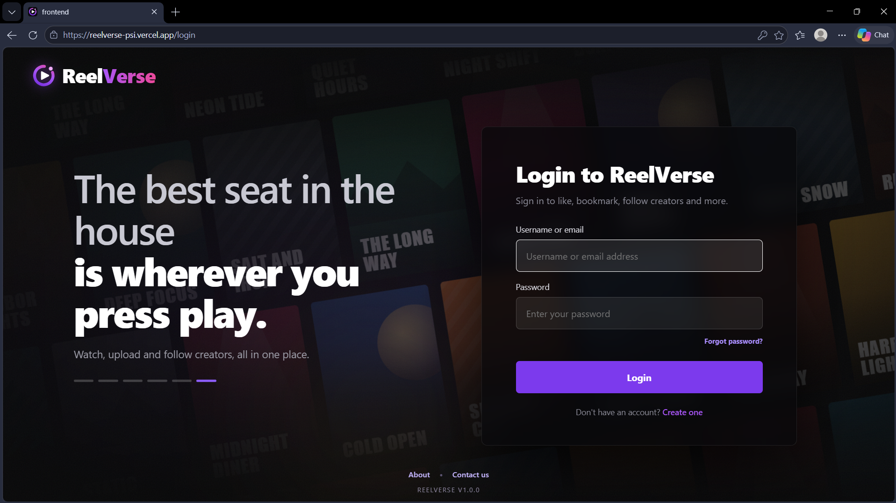
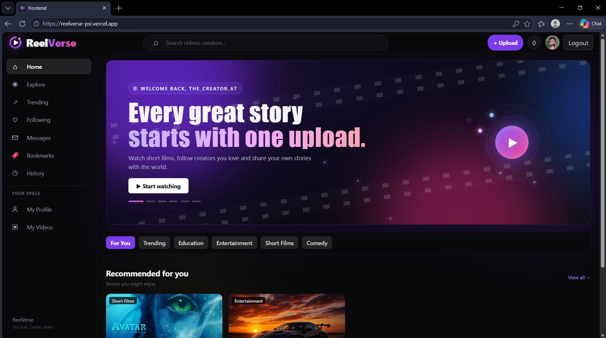
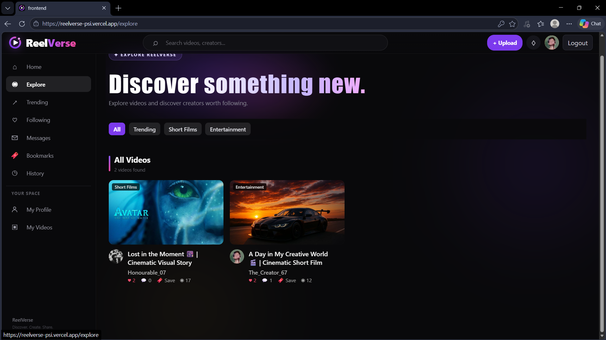
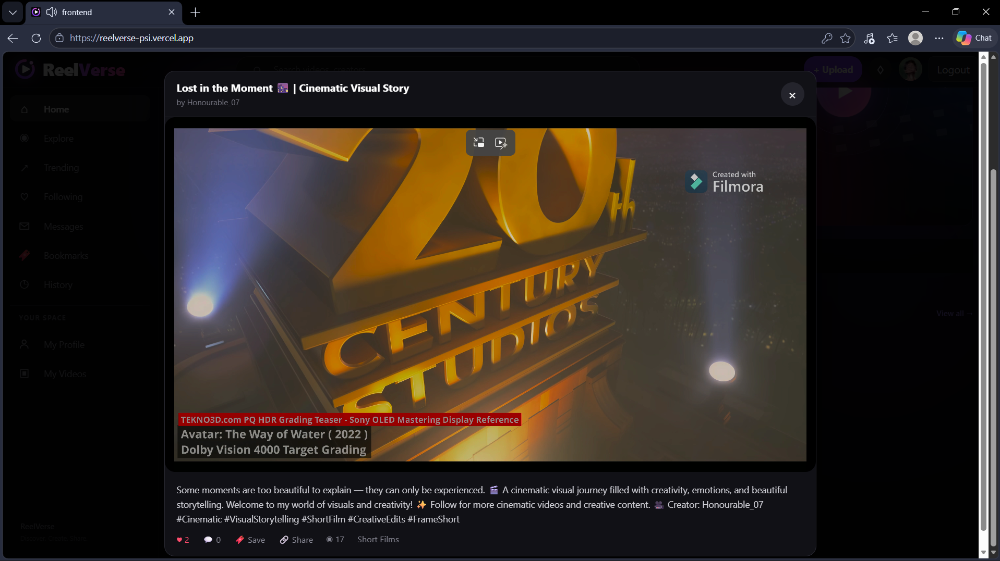
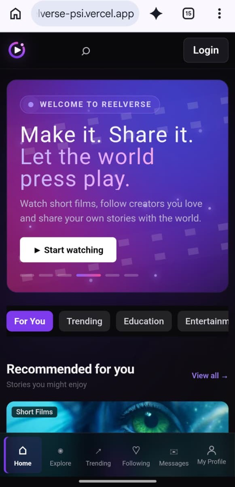
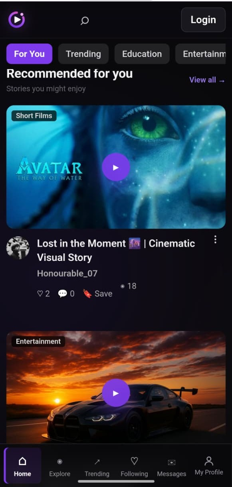

# ReelVerse

A full-stack video-sharing platform where creators upload videos, and viewers
discover, like, comment, save, follow and chat in real time.

**Live demo:** https://reelverse-psi.vercel.app
(The backend runs on a free tier and sleeps when idle, so the first load can
take up to a minute.)

## Screenshots

| Home | Home (more videos) |
|------|--------------------|
|  |  |

| Explore | Video page |
|---------|------------|
|  |  |

| Mobile | Mobile |
|--------|--------|
|  |  |

## Features

- Sign up / log in with email verification codes
- Upload videos with a live progress bar; large files (500 MB+) go straight to
  cloud storage in chunks
- Explore, Trending, Following, Bookmarks and Watch History pages
- Search with suggestions and search history
- Likes, comments, save and follow
- Real-time messaging
- Share links for videos and profiles
- Profile editing, including email change with a verification code
- Report video option
- Quality (resolution) selection in the video player
- Fully responsive: phones, tablets, laptops and large screens
- Dark violet theme

## Tech stack

| Part      | Technology                                             |
|-----------|--------------------------------------------------------|
| Frontend  | React, Vite, plain CSS                                 |
| Backend   | Python, Flask, SQLAlchemy, Flask-JWT-Extended, Socket.IO |
| Database  | PostgreSQL (Neon) in production, SQLite locally        |
| Storage   | Cloudflare R2 (videos), Cloudinary (images)            |
| Email     | SMTP (Brevo)                                           |
| Hosting   | Vercel (frontend), Render with Docker (backend)        |

## Project structure

```
backend/    Flask API (app/, routes, models, Dockerfile)
frontend/   React app (src/App.jsx, theme.css, index.css)
```

## Run it locally

### 1. Backend

```powershell
cd backend
python -m venv venv
.\venv\Scripts\python.exe -m pip install -r requirements.txt
copy .env.example .env        # then fill in your values
.\venv\Scripts\python.exe -m flask db upgrade
.\venv\Scripts\python.exe run.py
```

The API starts at http://127.0.0.1:5000

### 2. Frontend

```powershell
cd frontend
npm.cmd install
npm.cmd run dev
```

Open http://localhost:5173

## Environment variables

See `backend/.env.example` and `frontend/.env.example`.
Real secrets are never stored in this repository.

## Deployment

- **Backend:** Render (Docker), environment variables set in the Render dashboard
- **Frontend:** Vercel, with `VITE_API_URL` pointing to the backend
- **Database:** Neon PostgreSQL

## Author

Shafeek, BCA graduate, Bengaluru